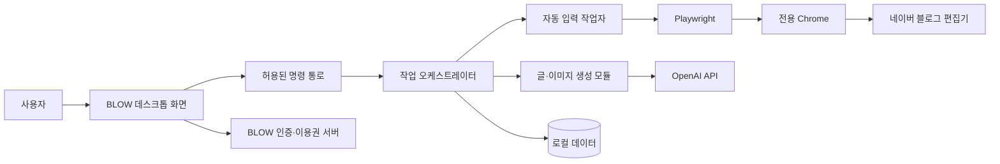
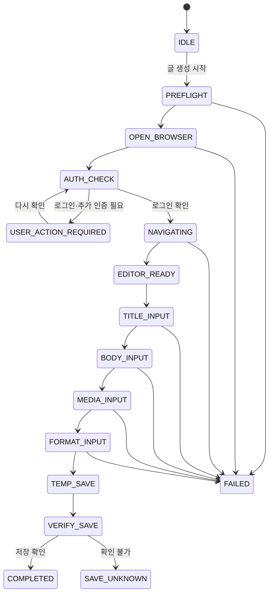

# BLOW 네이버 자동 입력 기술검증(POC) 명세 v1.0

> 문서 상태: 개발 착수 기준안
> 대상: Windows 데스크톱 MVP
> 작성일: 2026-09-03
> 관련 문서: `BLOW_PRD_v1.0.md`, `BLOW_UIUX_SCREEN_SPEC_v1.0.md`, `BLOW_UIUX_REDESIGN_DIRECTION_v2.0.md`

---

## 1. 이번 단계의 결론

BLOW의 네이버 입력 기능은 화면을 보고 마우스 좌표를 추측하는 “컴퓨터 유즈” 방식으로 만들지 않는다. 데스크톱 앱이 Playwright라는 브라우저 자동화 도구를 이용해 Chrome 페이지의 버튼, 입력 칸, 편집기 상태를 코드로 식별하고 조작한다.

구현 방향은 다음과 같이 확정한다.

1. BLOW는 웹사이트만으로 제공하지 않고 Windows 데스크톱 앱으로 제공한다.
2. 앱 화면은 Electron + React + TypeScript로 구현한다.
3. 네이버는 별도로 열리는 실제 Chrome 창에서 동작한다.
4. 사용자의 평소 Chrome 프로필은 사용하지 않는다.
5. `%LOCALAPPDATA%\BLOW\ChromeProfile`에 BLOW 전용 Chrome 프로필을 만든다.
6. 사용자가 전용 Chrome에서 네이버 로그인을 직접 한 번 완료하면 로그인 상태를 로컬에 유지한다.
7. 자동화 코드는 네이버 블로그 이동, 글쓰기 진입, 제목·본문·이미지·서식 입력, 임시저장 확인까지만 수행한다.
8. 최종 발행 버튼을 찾는 선택자와 클릭 기능은 코드에 만들지 않는다.
9. 자동화 대상이나 현재 화면을 확실히 식별하지 못하면 추측해서 클릭하지 않고 즉시 멈춘다.
10. POC를 통과한 기능만 MVP 범위에 포함한다.

### 왜 전용 Chrome 프로필이 필요한가

Chrome 136부터 기본 사용자 데이터 폴더에 대한 원격 디버깅 방식이 제한된다. Google은 자동화와 개인 프로필을 분리하도록 별도 `user-data-dir` 사용을 안내하고 있으며, Playwright도 기본 Chrome 프로필 자동화를 지원하지 않는다고 명시한다. 따라서 사용자는 평소 Chrome 로그인과 별개로, BLOW가 연 Chrome에서 네이버 로그인을 한 번 진행해야 한다.

- [Chrome 원격 디버깅 보안 변경](https://developer.chrome.com/blog/remote-debugging-port?hl=en)
- [Playwright 영구 브라우저 컨텍스트](https://playwright.dev/docs/api/class-browsertype#browser-type-launch-persistent-context)

---

## 2. POC의 목적

POC(기술검증)는 완성 프로그램을 만드는 단계가 아니라, 제품에서 가장 위험한 핵심 기능이 실제로 안정적으로 가능한지 작은 코드로 증명하는 단계다.

이번 POC에서 검증할 질문은 다음과 같다.

- 설치된 Chrome을 BLOW 전용 프로필로 안정적으로 실행할 수 있는가?
- 사용자가 로그인한 네이버 상태가 앱과 PC 재시작 후에도 유지되는가?
- 네이버 홈 또는 저장된 블로그 주소에서 글쓰기 편집기까지 안전하게 이동할 수 있는가?
- 제목과 본문을 줄바꿈 손상 없이 입력할 수 있는가?
- 이미지 첨부, 개별사진, 콜라주, 슬라이드가 반복 동작하는가?
- 스티커, 인용구, 구분선, 글꼴, 정렬을 원하는 위치에 적용할 수 있는가?
- 임시저장이 실제로 완료됐는지 확인할 수 있는가?
- 네이버 화면이 바뀌거나 예상하지 못한 팝업이 나타났을 때 안전하게 멈추는가?
- 어떤 오류 경로에서도 최종 발행 동작이 실행되지 않는가?

POC에서는 회원가입, 결제, 이용권, 관리자 화면, 실제 GPT 글 생성까지 함께 만들지 않는다. 자동 입력 가능성을 먼저 확인한 뒤 나머지 개발을 이어간다.

---

## 3. 전체 구조



### 3.1 데이터 이동 원칙

| 데이터 | 저장 위치 | BLOW 서버 전송 |
|---|---|---:|
| BLOW 회원 ID, 이용권 만료일, 기기 식별값 | 서버 | 필요 |
| 허용 모델·추론 강도 목록 | 서버에서 내려받고 로컬 캐시 | 필요 |
| OpenAI API 키 | Windows 로컬 보안 저장소 | 금지 |
| 네이버 로그인 쿠키·세션 | BLOW 전용 Chrome 프로필 | 금지 |
| 브랜드 프로필, 주제, 키워드, 본문 | 사용자 PC | 금지 |
| 첨부·생성 이미지 | 사용자 PC | 금지 |
| 토큰 사용량과 OpenAI 비용 | 저장·수집하지 않음 | 금지 |

OpenAI API 요청은 사용자 PC에서 OpenAI로 직접 보낸다. BLOW 서버가 API 키나 작성 내용을 중계하지 않는다.

---

## 4. 권장 프로젝트 구조

초기에는 TypeScript 한 언어로 데스크톱 앱, 자동화, 서버의 공통 자료형을 공유하는 구조를 권장한다.

```text
blow/
├─ apps/
│  ├─ desktop/                 # 사용자용 Windows 앱
│  │  ├─ src/main/             # Electron 메인 프로세스
│  │  ├─ src/preload/          # 화면에 제한된 기능만 노출
│  │  └─ src/renderer/         # React 대시보드 UI
│  └─ admin-web/               # 운영자용 회원·이용권 관리
├─ services/
│  └─ api/                     # 로그인·이용권·기기·허용 모델 API
├─ packages/
│  ├─ contracts/               # 앱과 서버가 공유하는 자료형
│  ├─ automation-core/         # 작업 상태, 중단, 오류, 검증
│  ├─ naver-adapter/           # 네이버 화면별 식별·조작 코드
│  ├─ content-core/            # 글 생성, 글자 수·키워드 검사
│  ├─ image-core/              # 이미지 생성·첨부·임시파일
│  └─ local-data/              # SQLite와 보안 저장소
├─ test-harness/
│  └─ mock-editor/             # 자동화 회귀 테스트용 가짜 편집기
└─ docs/
```

`naver-adapter`를 별도 패키지로 분리하는 이유는 네이버 화면이 바뀌었을 때 앱 전체가 아니라 해당 부분만 수정하고 재검증하기 위해서다.

---

## 5. Chrome 실행 전략

### 5.1 기본 방식

```ts
const context = await chromium.launchPersistentContext(profilePath, {
  channel: 'chrome',
  headless: false,
  viewport: null,
});
```

`launchPersistentContext`는 쿠키와 로그인 상태를 전용 폴더에 유지하는 실행 방식이다.

### 5.2 필수 규칙

- 프로필 경로는 BLOW가 만든 고정 폴더만 허용한다.
- 사용자의 일반 Chrome `User Data` 경로를 입력받거나 검색해 사용하지 않는다.
- 하나의 프로필은 동시에 하나의 BLOW 작업만 연다.
- 자동화 중인 Chrome은 숨기지 않고 사용자가 볼 수 있게 표시한다.
- 저장 불명확 상태에서는 사용자가 확인할 수 있도록 Chrome을 유지한다.
- 앱이 비정상 종료되면 다음 시작 때 이전 작업을 복구하지 않고 새 작업으로 시작한다.

### 5.3 설치 Chrome과 검증용 Chrome 비교

| 항목 | 사용자 설치 Chrome | Chrome for Testing 또는 번들 브라우저 |
|---|---|---|
| 사용자 기대와의 일치 | 높음 | 보통 |
| 추가 설치 용량 | 낮음 | 큼 |
| 자동화 버전 일치 | 상대적으로 불안정 | 높음 |
| 업데이트 통제 | 어려움 | 가능 |
| 권장 용도 | 제품 1차 후보 | 실패 시 대체 후보 |

POC에서는 두 방식을 모두 측정한다. 설치 Chrome이 최신 정식 버전과 직전 정식 버전에서 합격 기준을 통과하면 제품 기본값으로 사용한다. 통과하지 못하면 검증된 브라우저를 앱에 함께 제공하는 방식을 다시 검토한다. Playwright는 자체 번들 Chromium과의 호환성이 가장 높다고 안내한다.

- [Playwright 브라우저 지원 방식](https://playwright.dev/docs/browsers)

---
## 6. 네이버 화면을 찾고 클릭하는 방식

미리 모든 버튼의 화면 좌표를 저장하지 않는다. 각 화면의 HTML 구조에서 의미 있는 단서를 찾아 버튼을 식별한다.

### 6.1 식별 우선순위

1. 변경 가능성이 낮은 속성 또는 명시적 데이터 속성
2. 버튼·입력 칸의 역할과 접근성 이름
3. 특정 편집기 영역 또는 팝업 내부라는 위치 관계
4. 화면에 보이는 정확한 문구
5. 짧고 범위가 제한된 CSS 선택자

긴 CSS 경로나 XPath, 화면의 X·Y 좌표는 제품 자동화에 사용하지 않는다. Playwright 공식 가이드도 사용자가 인식하는 역할과 이름을 우선하고, DOM 구조에 강하게 묶인 긴 CSS/XPath는 쉽게 깨질 수 있다고 안내한다.

- [Playwright 로케이터 권장 방식](https://playwright.dev/docs/locators)
- [Playwright 자동 대기와 동작 가능성 검사](https://playwright.dev/docs/actionability)

### 6.2 모든 클릭 전 확인 항목

- 현재 주소가 허용된 네이버 도메인인가?
- 현재 화면이 예상 단계와 일치하는가?
- 대상 버튼이 정확히 한 개만 존재하는가?
- 버튼이 화면에 보이고 활성화되어 있는가?
- 팝업이나 추가 인증 화면이 버튼을 가리고 있지 않은가?

대상이 0개 또는 2개 이상이면 첫 번째 항목을 임의로 클릭하지 않는다. `SELECTOR_AMBIGUOUS` 오류로 중단한다.

### 6.3 화면 상태 분류

| 상태 코드 | 의미 | 다음 행동 |
|---|---|---|
| `NAVER_LOGIN_REQUIRED` | 네이버 로그인 필요 | 사용자가 로그인할 때까지 대기 |
| `NAVER_HOME` | 네이버 홈 확인 | 저장된 블로그 주소로 이동 |
| `BLOG_HOME` | 대상 블로그 확인 | 글쓰기 버튼 탐색 |
| `EDITOR_LOADING` | 편집기 로딩 중 | 제한 시간 안에서 대기 |
| `EDITOR_READY` | 제목·본문 입력 가능 | 자동 입력 시작 |
| `USER_ACTION_REQUIRED` | 보안문자·추가 인증·팝업 | 자동화 일시정지 |
| `UNKNOWN_PAGE` | 화면을 확실히 판별할 수 없음 | 안전 중단 |

---

## 7. 네이버 편집기 입력 모델

생성한 본문 전체를 한 번에 HTML로 붙여 넣지 않는다. 먼저 아래와 같은 “편집 작업 목록”으로 바꾼 후 순서대로 실행한다.

```ts
type EditorOperation =
  | { type: 'title'; text: string }
  | { type: 'paragraph'; id: string; text: string }
  | { type: 'imageGroup'; imageIds: string[]; layout: 'single' | 'collage' | 'slideshow' }
  | { type: 'sticker'; stickerId: string; anchorId: string; position: 'before' | 'after' }
  | { type: 'quote'; anchorId: string; paragraphIds: string[] }
  | { type: 'divider'; anchorId: string; position: 'before' | 'after' }
  | { type: 'font'; targetIds: string[]; fontId: string }
  | { type: 'align'; targetIds: string[]; value: 'left' | 'center' | 'right' };
```

사용자가 선택한 “위치”는 문단 번호가 아니라 고유한 `anchorId`로 연결한다. 앞 문단 길이가 바뀌어도 스티커·인용구·구분선이 잘못된 위치로 이동하지 않게 하기 위해서다.

### 7.1 제목과 본문

- 제목 입력 영역이 정확히 한 개이고 편집 가능 상태인지 확인한다.
- 기존 내용이 있다면 덮어쓰기 전에 빈 새 글인지 확인한다.
- 본문은 문단 단위로 입력한다.
- 각 문단 입력 후 실제 편집기 텍스트를 다시 읽어 원문과 비교한다.
- 공백, 줄바꿈, 특수문자가 손상되면 다음 단계로 진행하지 않는다.
- `fill()`이 편집기와 충돌하면 키 입력을 모사하는 `pressSequentially()` 방식을 제한적으로 사용한다.

### 7.2 이미지 첨부

- BLOW가 준비한 로컬 JPG 또는 PNG 파일만 파일 선택기에 전달한다.
- WebP가 불안정하면 사본을 JPG/PNG로 변환하되 사용자 원본은 수정하지 않는다.
- 업로드 완료 표시와 실제 삽입된 이미지 수를 둘 다 확인한다.
- 이미지 생성이 취소되면 완성된 이미지만 사용하고 나머지 글 입력을 계속한다.
- 이미지 업로드가 일부 실패하면 성공한 이미지 수를 표시하고 계속 진행한다.

### 7.3 개별사진·콜라주·슬라이드

1. 배치에 포함할 이미지 수가 조건을 만족하는지 확인한다.
2. 이미지 도구를 연다.
3. 정확한 배치 메뉴를 선택한다.
4. 대상 이미지를 업로드 또는 선택한다.
5. 편집기에 만들어진 그룹 유형과 이미지 수를 확인한다.

메뉴 이름이나 구조가 달라져 그룹 유형을 확인할 수 없으면 기본 개별사진으로 임의 변경하지 않고 작업을 멈춘다.

### 7.4 스티커·인용구·구분선

- 먼저 기준 문단 `anchorId`를 찾는다.
- 기준 문단 앞 또는 뒤에 빈 삽입 지점을 만든다.
- 도구 모음에서 정확한 기능을 연다.
- 사용자가 선택한 항목 또는 스타일을 적용한다.
- 삽입된 요소가 기준 문단과 올바른 순서인지 재확인한다.

스티커는 네이버가 제공하는 목록과 식별 방식이 바뀔 수 있어 POC의 독립 합격 항목으로 둔다. 안정적으로 특정 스티커를 식별하지 못하면 MVP에서 “스티커 사용 여부와 위치”까지만 자동화하고, 종류 선택은 사용자가 Chrome에서 마무리하는 축소안을 별도 판단한다.

### 7.5 글꼴과 정렬

- 적용할 문단 범위를 먼저 선택한다.
- 글꼴 메뉴가 열린 상태인지 확인한 뒤 정확한 글꼴을 선택한다.
- 정렬 버튼은 현재 활성 상태와 목표 상태를 비교한 후 필요한 경우에만 클릭한다.
- 적용 후 DOM 속성, 활성 툴바 상태 또는 편집기 내부 스타일을 읽어 결과를 확인한다.

---

## 8. 임시저장과 발행 방지

### 8.1 임시저장 성공 조건

아래 신호 중 네이버 편집기에서 실제로 확인 가능한 두 가지 이상을 POC에서 선정한다.

- 임시저장 완료 안내 문구
- 저장 중 표시가 사라짐
- 임시저장 시각 또는 상태값 변경
- 임시글 목록에서 제목 확인
- 편집기 재진입 후 제목·본문 일부 확인

한 가지 신호만으로 성공 처리하지 않는 것을 권장한다. 제한 시간 안에 성공을 확정하지 못하면 `TEMP_SAVE_UNCONFIRMED`로 종료하고 Chrome 창을 유지한다.

### 8.2 최종 발행 방지 장치

- 자동화 명령 목록에 `publish` 작업 유형을 정의하지 않는다.
- 네이버 발행 버튼 선택자를 선택자 목록에 저장하지 않는다.
- 허용 클릭 목록에 임시저장 관련 명령만 등록한다.
- 자동화 테스트에서 발행 관련 네트워크 요청이 0건인지 확인한다.
- 코드 검토에서 발행 관련 동작 문자열을 금지 목록으로 검사한다.
- 완료 화면에는 “네이버 임시저장을 완료했습니다”만 사용한다.

사용자는 전용 Chrome에서 결과를 직접 확인하고 최종 발행한다.

---

## 9. 작업 상태 기계

상태 기계는 프로그램이 지금 어느 단계인지 명확히 기록하고, 예상하지 못한 순서로 클릭하지 못하게 하는 장치다.



### 9.1 사용자 조작 감지

자동 입력 중에는 사용자가 Chrome을 직접 조작하지 않도록 진행 화면에 안내한다. 다음 변화가 감지되면 자동 입력을 일시정지한다.

- 예상하지 못한 주소 이동
- 편집기 포커스나 선택 영역의 갑작스러운 변경
- 이미 입력한 문단 내용의 변경
- 작업 대상이 아닌 탭으로 전환
- 예상하지 못한 팝업 또는 다이얼로그 출현

모든 사람의 마우스·키보드 조작을 100% 구분하는 것은 현실적으로 어렵다. 따라서 자동화가 기대한 화면과 내용이 달라지는 순간 멈추는 보수적 방식을 사용한다.

---
## 10. 오류 코드와 사용자 안내

| 내부 오류 코드 | 사용자 문구 | 처리 |
|---|---|---|
| `CHROME_NOT_FOUND` | Chrome을 찾을 수 없습니다. Chrome 설치를 확인해 주세요. | 중단 |
| `CHROME_UNSUPPORTED` | 현재 Chrome 버전에서는 작업을 시작할 수 없습니다. | 중단·업데이트 안내 |
| `PROFILE_IN_USE` | BLOW 전용 Chrome이 이미 실행 중입니다. | 기존 창으로 이동 |
| `NAVER_LOGIN_REQUIRED` | 전용 Chrome에서 네이버에 로그인해 주세요. | 대기 |
| `NAVER_AUTH_REQUIRED` | Chrome에서 추가 인증을 완료해 주세요. | 대기 |
| `NAVER_PAGE_UNKNOWN` | 네이버 화면을 확인할 수 없어 작업을 멈췄습니다. | Chrome 유지 |
| `EDITOR_NOT_READY` | 글쓰기 화면을 열지 못했습니다. 다시 시도해 주세요. | 중단 |
| `SELECTOR_AMBIGUOUS` | 화면이 예상과 달라 작업을 멈췄습니다. | 중단·진단 기록 |
| `CONTENT_MISMATCH` | 입력 내용을 확인할 수 없어 작업을 멈췄습니다. | 중단 |
| `IMAGE_UPLOAD_FAILED` | 일부 이미지를 넣지 못했습니다. 성공한 작업은 유지됩니다. | 조건부 계속 |
| `USER_INTERACTION_DETECTED` | Chrome 조작이 감지되어 작업을 일시정지했습니다. | 사용자 확인 |
| `TEMP_SAVE_UNCONFIRMED` | 임시저장 여부를 직접 확인해 주세요. | Chrome 유지 |
| `AUTOMATION_STOPPED` | 작업을 중단했습니다. | 종료 |

내부 코드와 기술 상세는 사용자 화면에 그대로 노출하지 않는다.

---

## 11. 로컬 기록과 개인정보 보호

### 11.1 기록하는 항목

- 무작위 작업 ID
- 앱 버전, Chrome 버전, 네이버 어댑터 버전
- 작업 단계 이름과 시작·종료 시각
- 성공, 실패, 중단, 사용자 확인 필요 상태
- 오류 코드
- 선택자 자체가 아닌 선택자 키 이름
- 각 단계의 소요 시간

### 11.2 기록하지 않는 항목

- OpenAI API 키
- 네이버 쿠키·세션·비밀번호
- 제목, 본문, 키워드, 참고자료
- 이미지 파일 또는 이미지 원문 경로
- 화면 캡처
- 토큰 사용량과 비용
- URL의 검색어·쿼리 문자열

고객센터용 진단 파일은 사용자가 직접 “진단 정보 저장” 버튼을 누른 경우에만 만든다. 이 파일에도 콘텐츠와 비밀정보를 넣지 않는다.

---

## 12. 데스크톱 앱 보안 기준

- UI 화면에는 로컬에 패키징된 코드만 불러온다.
- `nodeIntegration`은 끈다.
- `contextIsolation`과 렌더러 프로세스 샌드박스를 켠다.
- 화면과 운영체제 기능 사이는 허용 목록으로 만든 제한된 IPC 명령만 사용한다.
- 모든 IPC 요청의 호출 화면, 자료형, 파일 경로를 검사한다.
- 네이버 페이지를 권한이 있는 Electron 화면 안에 직접 넣지 않고 별도 Chrome에서 연다.
- 사용자 입력으로 셸 명령을 만들거나 `eval`로 코드를 실행하지 않는다.
- 외부 주소 열기는 허용 도메인과 HTTPS 여부를 확인한다.

Electron은 원격 콘텐츠에 Node.js 기능을 노출하지 않고, context isolation·sandbox·CSP·IPC 발신자 검증을 적용하도록 권장한다.

- [Electron 보안 권고](https://www.electronjs.org/docs/latest/tutorial/security)
- [Electron Context Isolation](https://www.electronjs.org/docs/latest/tutorial/context-isolation)

### 12.1 API 키 보관

API 키는 Electron `safeStorage`의 비동기 암호화 API를 이용해 Windows DPAPI로 보호한다. 암호화된 값만 로컬 디스크에 저장한다.

중요한 한계가 있다. Windows DPAPI는 다른 Windows 사용자 계정으로부터는 보호하지만, 같은 Windows 계정 권한으로 실행되는 악성 프로그램까지 막아 주지는 못한다. 따라서 API 키 원문을 로그·진단 파일·서버 요청에 절대 포함하지 않는 추가 보호가 필요하다.

- [Electron safeStorage](https://www.electronjs.org/docs/latest/api/safe-storage)

---

## 13. POC 구현 단계

### POC-0. 가짜 편집기 테스트 환경

- 제목, 본문, 이미지, 툴바, 임시저장 버튼을 가진 로컬 테스트 페이지 제작
- 정상 화면, 팝업, 버튼 중복, 로딩 지연, 요소 변경 시나리오 제공
- 네이버에 접속하지 않고 상태 기계와 안전 중단을 반복 테스트

### POC-1. 전용 Chrome 프로필

- 설치된 Chrome 탐지
- BLOW 전용 프로필 생성
- 중복 실행 잠금
- 수동 네이버 로그인
- 앱·Chrome·PC 재시작 후 로그인 유지 확인

### POC-2. 블로그와 글쓰기 이동

- 저장된 블로그 주소 검증
- 블로그 소유 관계와 로그인 상태 확인
- 글쓰기 버튼 식별
- 새 글 편집기 준비 상태 확인

### POC-3. 제목과 본문 입력

- 제목 입력
- 여러 문단과 빈 줄 입력
- 한글, 영문, 숫자, 문장부호, 이모지 입력
- 원본과 편집기 결과 비교

### POC-4. 이미지

- 이미지 0장, 1장, 여러 장
- JPG, PNG, WebP 변환 사본
- 개별사진, 콜라주, 슬라이드
- 일부 실패와 이미지 생성 취소 이후 계속 진행

### POC-5. 서식

- 스티커와 위치
- 인용구와 위치
- 구분선과 위치
- 글꼴
- 왼쪽, 가운데, 오른쪽 정렬
- 모바일·PC 가독성에 따른 문단과 간격

### POC-6. 임시저장

- 임시저장 클릭
- 성공 신호 2중 확인
- 저장 실패
- 저장 여부 확인 불가
- Chrome 유지와 사용자 안내

### POC-7. 중단과 예외

- 사용자의 전체 작업 중단
- 사용자 Chrome 조작
- 로그인 만료와 추가 인증
- 네트워크 끊김
- 네이버 화면 구조 변경
- 앱 강제 종료 후 새 작업 시작

### POC-8. 호환성 반복 검증

- 지원 대상 Windows 버전
- Chrome 최신 정식 버전
- Chrome 직전 정식 버전
- 디스플레이 배율 100%, 125%, 150%
- 느린 네트워크
- 최소 20회 연속 핵심 시나리오

DOM 기반 자동화이므로 화면 배율은 원칙적으로 클릭 정확도에 영향을 주지 않아야 한다. 배율 테스트는 화면 표시와 예상하지 못한 반응 여부를 확인하는 용도다.

---

## 14. 합격 기준

| 검증 항목 | 합격 기준 |
|---|---:|
| 전용 프로필 생성과 재실행 | 10회 중 10회 성공 |
| 재시작 후 네이버 로그인 유지 | 10회 중 10회 성공 |
| 블로그에서 편집기 이동 | Chrome 버전별 20회 연속 성공 |
| 제목·본문 입력과 내용 비교 | 20회 중 20회 일치 |
| 이미지 개별 첨부 | 조합별 10회 중 10회 성공 |
| 콜라주·슬라이드 | 방식별 10회 중 10회 성공 |
| 스티커·인용구·구분선 | 기능별 10회 중 10회 성공 |
| 글꼴·정렬 | 조합별 10회 중 10회 성공 |
| 임시저장 확인 | 20회 중 20회 성공 또는 불명확 상태 정확히 중단 |
| 화면 변경·버튼 중복 | 오작동 클릭 0회 |
| 최종 발행 | 클릭·요청 0회 |
| 기본 Chrome 프로필 접근 | 0회 |
| BLOW 서버로 콘텐츠·API 키 전송 | 0건 |
| 같은 프로필 동시 실행 | 100% 차단 |

성공률이 기준에 못 미치면 실패 원인을 수정한 뒤 처음부터 다시 측정한다. 평균 성공률만 높고 특정 단계가 불안정한 상태는 합격으로 처리하지 않는다.

---
## 15. 테스트 계정과 검증 환경

- 개인 운영 계정이 아닌 개발 전용 네이버 테스트 계정을 사용한다.
- 실제 공개 글을 발행하지 않는다.
- 임시글 제목에는 테스트임을 식별할 수 있는 무작위 번호를 붙인다.
- 테스트 후 임시글 정리는 자동화 기능과 분리해 수동으로 진행한다.
- 실제 고객의 글, 이미지, API 키는 POC에 사용하지 않는다.
- 네이버 편집기 구조를 기록하는 화면 캡처와 HTML 자료는 개발 내부에만 보관하고 사용자 콘텐츠를 포함하지 않는다.

사용자가 개발 단계에서 직접 준비해야 하는 것은 개발 전용 네이버 계정 한 개다. 비밀번호를 개발 코드나 문서에 적지 않고, 전용 Chrome 창에서 직접 로그인한다.

---

## 16. 산출물

POC 완료 시 다음 자료가 남아야 한다.

1. 실행 가능한 Windows용 내부 테스트 앱
2. BLOW 전용 Chrome 프로필 실행 모듈
3. 네이버 화면 상태 판별기
4. 제목·본문·이미지·서식 입력 어댑터
5. 임시저장 확인 모듈
6. 발행 기능 부재를 검증하는 자동 테스트
7. 로컬 가짜 편집기와 회귀 테스트
8. Chrome 버전별 20회 반복 결과표
9. 실패한 선택자와 수정 이력을 담은 호환성 보고서
10. MVP 진행, 기능 축소 또는 대체안 중 하나의 최종 판단

---

## 17. 진행·축소·중단 판단

### 진행

핵심 합격 기준을 모두 통과하면 계정·이용권·기기 제한, 로컬 저장, GPT 생성, 관리자 화면을 포함한 MVP 개발로 진행한다.

### 조건부 진행

제목·본문·이미지·임시저장은 안정적이지만 일부 서식만 불안정하면 불안정한 기능만 MVP에서 제외하거나 사용자가 직접 마무리하는 기능으로 축소한다. 어떤 기능을 축소할지는 POC 수치와 구현 비용을 제시한 뒤 결정한다.

### 기술적 중단

편집기 진입, 기본 입력 또는 임시저장 확인이 반복 기준을 통과하지 못하면 자동 입력 MVP를 그대로 개발하지 않는다. 이 경우 생성 결과를 복사하고 사용자가 네이버에 붙여 넣는 보조 방식은 제품 대체안으로만 보고하며, 임의로 제품 방향을 변경하지 않는다.

---

## 18. 비용과 운영상 주의점

POC의 브라우저 자동화 자체에는 별도의 사용량 기반 API 비용이 없다. 실제 GPT 글·이미지 생성 검증을 시작할 때부터 사용자의 OpenAI 계정에 달러 기준 API 비용이 발생한다.

추후 정식 배포에는 다음 비용 또는 준비가 추가될 수 있다.

- Windows 코드 서명 인증서: 설치 경고를 줄이기 위한 유료 인증서
- 인증·이용권 서버와 데이터베이스 운영비
- 오류 수집 또는 업데이트 배포 서비스 비용
- 검증용 Windows PC 또는 가상 환경

네이버와 Chrome 화면 변경은 출시 후에도 발생할 수 있으므로 일회성 개발로 끝나지 않는다. 지원 Chrome 범위에 대한 자동 회귀 테스트와 네이버 어댑터 유지보수는 계속 필요하다.

---

## 19. 바로 다음 개발 작업

다음 작업은 완성 앱 전체가 아니라 POC 코드 저장소를 만드는 것이다.

1. TypeScript 작업 공간 초기화
2. Electron 최소 실행 화면 구성
3. `automation-core` 상태 기계 작성
4. 로컬 가짜 편집기 제작
5. 가짜 편집기에서 제목·본문·임시저장 자동화 테스트
6. BLOW 전용 Chrome 프로필 실행 기능 추가
7. 개발 전용 네이버 계정으로 실제 편집기 구조 조사
8. 실제 네이버 어댑터를 한 기능씩 추가

첫 코드 단계의 완료 기준은 “BLOW 테스트 앱에서 버튼을 누르면 전용 Chrome이 열리고, 로컬 가짜 편집기에 제목과 본문을 입력한 뒤 임시저장 성공을 확인하는 것”이다. 이 기준을 통과한 뒤 실제 네이버 연결로 넘어간다.

---

## 20. 이번 문서에서 확정하지 않는 항목

- 업종별 광고법 RAG 자료 구조와 적용 시점
- 실제 OpenAI 모델 ID와 모델별 추론 강도 목록
- 월 이용 가격과 결제 페이지
- 코드 서명 인증서 공급사
- 설치 Chrome과 번들 브라우저 중 최종 제품 기본값
- 네이버 편집기의 실제 선택자 값

OpenAI 모델과 추론 단계는 변경될 수 있으므로 코드에 고정된 화면 목록으로 박아 두지 않는다. 서버가 활성 모델, 표시 이름, 허용 추론 단계만 내려주고, 사용자는 허용된 조합 안에서 선택하게 한다. BLOW는 모델 비교 기능이나 토큰 사용 기록을 제공하지 않는다.

---

## 21. 공식 기술 참고자료

- [Chrome: 원격 디버깅 보안 변경](https://developer.chrome.com/blog/remote-debugging-port?hl=en)
- [Playwright: BrowserType와 영구 컨텍스트](https://playwright.dev/docs/api/class-browsertype)
- [Playwright: 브라우저 채널](https://playwright.dev/docs/browsers)
- [Playwright: 안정적인 로케이터](https://playwright.dev/docs/locators)
- [Playwright: 자동 대기와 클릭 조건](https://playwright.dev/docs/actionability)
- [Electron: 보안 권고](https://www.electronjs.org/docs/latest/tutorial/security)
- [Electron: Context Isolation](https://www.electronjs.org/docs/latest/tutorial/context-isolation)
- [Electron: safeStorage](https://www.electronjs.org/docs/latest/api/safe-storage)
- [OpenAI: 추론 모델 가이드](https://developers.openai.com/api/docs/guides/reasoning)
- [OpenAI: 이미지 생성 가이드](https://developers.openai.com/api/docs/guides/image-generation)
